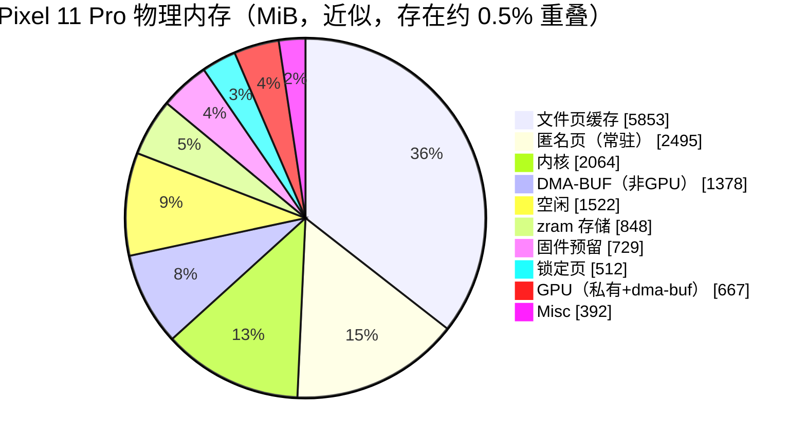
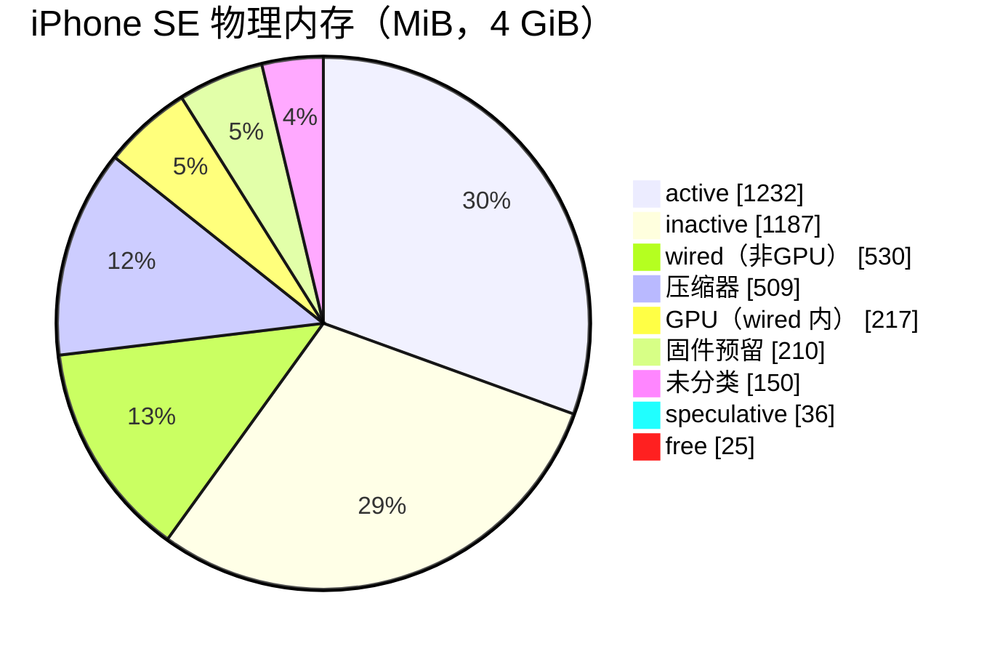

# iPhone SE (A15) 与 Pixel 11 Pro (Tensor G6) 内存子系统实测分析

采集时间：2026-10-19 23:14–23:17（EDT）
采集主机：Mac mini，两台手机均通过 USB 直连
权限条件：Pixel 未 root（adb shell，uid 2000）；iPhone 未越狱，开启开发者模式

本报告回答四个问题：系统内存整体被谁占用；内存在 CPU、GPU、NPU 之间如何归属；各类页状态（活跃、非活跃、wired、文件页、匿名页等）的实际用量；压缩内存（Android zram / iOS VM compressor）的具体运行状况。所有数字都来自 `data/` 下的原始采集文件，可逐项核对。

---

## 目录

1. [设备清单](#1-设备清单)
2. [方法与数据来源](#2-方法与数据来源)
3. [前提：统一内存架构下的"分配"](#3-前提统一内存架构下的分配)
4. [Pixel 11 Pro](#4-pixel-11-pro)
5. [iPhone SE (3rd gen)](#5-iphone-se-3rd-gen)
6. [两种内存管理模型的对比](#6-两种内存管理模型的对比)
7. [结论](#7-结论)
8. [局限与未覆盖项](#8-局限与未覆盖项)
9. [复现](#9-复现)
10. [仓库结构](#10-仓库结构)

---

## 1. 设备清单

| | iPhone SE (3rd gen) | Pixel 11 Pro |
|---|---|---|
| 型号标识 | iPhone14,6 / D49AP / MMX73 | grizzly |
| SoC | Apple A15 (T8110, ChipID 33040) | Google Tensor G6 |
| 系统版本 | iOS 27.0 (24A437) | Android 17, CD1A.260905.001.B1 |
| 内核 | XNU | Linux 6.12.69-android16-6 (4K page) |
| 物理 DRAM | 4 GiB | 16 GiB Samsung LPDDR5 (`ro.boot.hardware.ddr`) |
| 系统可见内存 | 3,886 MiB (`physMemSize` 248,678 页) | 15,655 MiB (`MemTotal`) |
| 固件/安全预留 | 约 210 MiB | 约 729 MiB |
| 页大小 | 16 KB | 4 KB |
| CPU | 6 核（2P + 4E） | 7 核：2 × 2.649 GHz、4 × 3.379 GHz、1 × 4.109 GHz（CPU part 0xd8b ×6、0xd8c ×1） |
| GPU | Apple AGX G14P，`core_mask` 0b11011，启用 4 核 | Imagination PowerVR（`/dev/pvr_sync`、`sscd_powervr`），devfreq 15 档，采样时 460 MHz |
| NPU / 加速器 | Apple Neural Engine，H14 架构，16 核 | EdgeTPU "santafe"（devfreq 4 档）+ GXP DSP（devfreq 4 档） |
| IOMMU | 每个 IP 独立 DART（dart-ane、dart-isp、dart-disp0、dart-ave、dart-avd …） | ARM SMMU，GPU 专用 `gpu_smmu`（TCU + 3 个 TBU） |
| 运行时长 | 约 10-18 重启后（Jetsam 计数器在 10-18 归零） | 33.53 天（`/proc/uptime` 2,897,327 s） |

---

## 2. 方法与数据来源

### Pixel（adb，非 root）

| 数据 | 命令 | 文件 |
|---|---|---|
| 内核内存分类 | `cat /proc/meminfo` | `data/pixel/meminfo.txt` |
| VM 累计计数器 | `cat /proc/vmstat` | `data/pixel/vmstat.txt` |
| 进程 PSS、OOM 分级、DMA-BUF、GPU、ZRAM 汇总 | `dumpsys meminfo` | `data/pixel/dumpsys_meminfo.txt`、`top_pss.txt` |
| GPU 按进程 | `dumpsys gpu --gpumem` | `data/pixel/gpumem.txt` |
| dma-buf heap 列表 | `ls /dev/dma_heap` | `data/pixel/dmabuf.txt` |
| 加速器设备节点、devfreq | `/sys/class/*`、`/dev` | `accel.txt`、`devfreq.txt` |
| LMK 统计与日志 | `dumpsys activity lmk`、`exit-info`、logcat | `lmk.txt`、`lmklog.txt` |
| 进程统计 | `dumpsys procstats --hours 3` | `procstats.txt` |

### iPhone（libimobiledevice + pymobiledevice3，非越狱）

| 数据 | 通道 | 文件 |
|---|---|---|
| 实时 VM 页状态、压缩器、swap | DVT `sysmon system`（Instruments 同源服务，`--native` 隧道） | `data/iphone/sysmon.txt` |
| 逐进程 footprint / 压缩量 | DVT `sysmon process single` | `data/iphone/proc_single.txt` |
| GPU 性能统计 | IORegistry `AGXAcceleratorG14P` → `PerformanceStatistics` | `data/iphone/agx.json` |
| ANE 设备属性与电源状态 | IORegistry `H11ANE` | `data/iphone/ane.json` |
| 内存控制器 | IORegistry `mcc` | `data/iphone/mcc.json` |
| 完整 IOService 树 | `idevicediagnostics ioreg IOService` | `data/iphone/ioreg_service.plist` |
| 杀进程瞬间的内存快照（27 天 12 份） | crash report 服务 `JetsamEvent-*.ips` | `data/iphone/jetsam/`，汇总 `jetsam_summary.txt` |

采集本身对 Pixel 有扰动：`dumpsys meminfo` 会逐进程收集统计，采集期间 lmkd 在 23:14:03 杀掉了 Outlook。Pixel 的 meminfo 与 dumpsys 是相隔数秒的两次快照，swap 用量在此期间从 4.2 GiB 降到 2.6 GiB 再回升到 3.4 GiB，因此第 4 节同时给出多次采样的范围。

---

## 3. 前提：统一内存架构下的"分配"

两台设备都是 UMA（Unified Memory Architecture）。SoC 内的 CPU、GPU、NPU、ISP、显示控制器、视频编解码器共用同一组 LPDDR 通道。GPU 没有独立显存；NPU 没有操作系统可见的私有 DRAM，它的片上 SRAM 与系统级缓存（SLC）不出现在任何内存统计中。

因此"内存在 CPU / GPU / NPU 上的分配"在物理上不存在固定划分。可测量的对象是物理页的持有关系：

- 页由谁分配（内核 slab、用户进程匿名页、文件缓存、驱动私有页、dma-buf / IOSurface 共享缓冲）；
- 页通过哪个 IOMMU 映射给哪个加速器（Pixel：SMMU 上下文；iPhone：各 IP 的 DART mapper）。

同一块 dma-buf 或 IOSurface 可以同时被 CPU 进程和 GPU/NPU 映射，所以"按加速器拆分"天然存在重叠。下文按持有者归类，并在有重叠的地方注明。

---

## 4. Pixel 11 Pro

### 4.1 /proc/meminfo 分类（第一次快照）

| 类别 | MiB | 含义 |
|---|---:|---|
| MemTotal | 15,655 | 内核可管理的全部物理页 |
| MemFree | 1,522 | 完全空闲 |
| MemAvailable | 6,612 | 内核估计无需换出即可回收的量 |
| Active(file) | 1,344 | 最近访问的文件页 |
| Inactive(file) | 4,509 | 可直接丢弃的文件页 |
| Active(anon) | 1,033 | 活跃匿名页（堆、栈） |
| Inactive(anon) | 1,462 | 待换出到 zram 的匿名页 |
| Unevictable / Mlocked | 512 | 被 mlock 锁定 |
| Shmem | 265 | 共享内存 / tmpfs / memfd |
| Mapped | 1,731 | 被进程映射的文件页 |
| Slab | 1,134 | 其中 SReclaimable 419，SUnreclaim 716 |
| KernelStack | 180 | |
| PageTables | 311 | |
| VmallocUsed | 418 | |
| Percpu | 21 | |
| Gpu | 446 | GPU 驱动上报的总量 |
| ION_heap | 1,684 | dma-buf heap 已分配 |
| ION_heap_pool | 19 | dma-buf heap 页池 |
| Zram | 848 | zram 压缩数据占用的物理内存 |
| Misc | 392 | 厂商自定义字段，非 root 无法拆分 |
| CmaTotal / CmaFree | 756 / 0 | CMA 区域全部借出 |
| SwapTotal / SwapFree | 7,828 / 3,620 | swap 已用 4,208 |
| SwapCached | 7 | |
| AnonHugePages | 0 | THP 关闭（`[never]`） |
| Committed_AS | 549,481（536.6 GiB） | 虚拟承诺量，主要是 ART、scudo、GPU VA 预留，不对应物理页 |

### 4.2 按持有者归属

| 持有者 | MiB | 依据 |
|---|---:|---|
| 固件 / TrustZone / modem / AoC / pKVM 等预留 | ≈729 | 16,384 − MemTotal |
| CPU 用户态匿名页（常驻） | 2,495 | Active(anon) + Inactive(anon) |
| CPU 用户态匿名页（压缩在 zram 中，原始大小） | 2,612–4,208 | 多次采样的 swap 已用量 |
| 文件页缓存 | 5,853 | Active(file) + Inactive(file) |
| 锁定页 | 512 | Unevictable |
| 内核 | ≈2,064 | Slab + KernelStack + PageTables + Vmalloc + Percpu |
| GPU | 667 | dumpsys：308 驱动私有 + 359 dma-buf |
| 非 GPU 的 DMA-BUF（相机、显示、编解码、音频、传感器、TPU/GXP） | ≈1,378 | dumpsys DMA-BUF 1,737 − GPU dma-buf 359 |
| zram 存储本身 | 770–848 | dumpsys ZRAM / meminfo Zram |
| pKVM 受保护虚拟机 | 214 | crosvm_tartarus_vm 120.8 + crosvm_isolated_storage_service_vm 93.5（PSS） |
| CMA | 756 | 全部被借用，与上面若干项重叠 |



dumpsys 汇总（三次采样范围）：

| 指标 | 范围 |
|---|---|
| Used RAM | 8.70–9.25 GiB（used PSS 5.5–6.1 GiB + kernel 3.15 GiB） |
| Free RAM | 7.78–9.16 GiB（cached PSS + cached kernel + free） |
| Lost RAM | 0.36–0.96 GiB |
| DMA-BUF | 1,737 MiB（mapped 527 + unmapped 1,210） |
| Kernel CMA | 17.7 MiB |
| 内存档位 | `Tuning: 256 (large 512), oom 322,560K, restore limit 107,520K (high-end-gfx)` |

### 4.3 GPU

`dumpsys gpu --gpumem` 全局 666.7 MiB，与 `dumpsys meminfo` 的 GPU 666.7 MiB 一致。其中 308 MiB 是驱动私有页（命令缓冲、页表、着色器、内部 heap），359 MiB 是与 CPU 进程共享的 dma-buf（图形缓冲、纹理）。

| PID | 进程 | GPU MiB |
|---:|---|---:|
| 994 | surfaceflinger | 131.5 |
| 2071 | com.android.systemui | 129.1 |
| 31051 | com.nourishrx.app（前台） | 87.5 |
| 4138 | nexuslauncher | 71.8 |
| 2369 | pixeldisplayservice | 63.4 |
| 28566 | com.google.android.as（Android System Intelligence） | 31.0 |
| 3917 | chrome:privileged_process0 | 25.2 |
| 1408 | system_server | 19.7 |
| 10512 | camera.provider HAL | 15.7 |
| 21785 | googlequicksearchbox | 14.8 |
| 2839 | inputmethod.latin | 13.4 |
| 14882 | com.tencent.mm | 8.4 |

PSS 分类中的 GL mtrack 325 MiB 与 EGL mtrack 306 MiB 是 GPU 内存按进程摊入 PSS 的部分，与上表同源。

显示合成：屏幕 1080×2410，SurfaceFlinger `NUM_FRAMEBUFFER_SURFACE_BUFFERS=3`，RGBA8888 单帧约 9.9 MiB。

### 4.4 NPU（EdgeTPU santafe、GXP）

可确认的事实：

- 设备节点 `/dev/edgetpu-soc`、`/dev/edgetpu-limited`（system 组）、`/dev/gxp`；
- 专用 dma-buf heap `tpu_offload_heap`（root 专属，`crw------- root`），另有 Face Unlock 相关的安全 heap：`faceauth_tpu-secure`、`famodel-secure`、`faprev-secure`、`farawimg-secure`；
- TPU 与 GXP 各有 4 档 devfreq。

不可读取的部分：逐 buffer 的 dma-buf 统计（`dmabuf_dump` 返回 `Unable to read DMA-BUF per-buffer stats`）、`/sys/kernel/dma_heap`、TPU sysfs 目录，全部被 SELinux 拒绝。

结论：TPU/GXP 的内存上限落在 1,378 MiB 的非 GPU dma-buf 中，无法从相机、显示、编解码等用途中单独拆出。CPU 一侧可见的端侧 AI 进程：

| 进程 | PSS MiB | 其中 swap |
|---|---:|---:|
| com.google.android.as | 167.4 | 30.5 |
| com.google.android.aicore:isolated_service | 119.0 | 68.3 |

### 4.5 zram 压缩内存

| 采样 | zram 物理占用 | 承载原始数据 | 压缩比 |
|---|---:|---:|---:|
| dumpsys #1（杀进程进行中） | 770 MiB | 2,612 MiB | 3.39 |
| dumpsys #2 | 780 MiB | 3,415 MiB | 4.38 |
| dumpsys #3 | 777 MiB | 3,345 MiB | 4.31 |
| dumpsys #4 | 790 MiB | 3,571 MiB | 4.52 |

配置：

- swap 设备容量 7.64 GiB，为物理内存的 50%；
- 实现为 Google 的 `zram_gs` 模块 + `zsmalloc`；
- `ro.zram_backing_device_min_free_mb=1536`：存储剩余超过 1.5 GB 时允许 zram 回写到闪存。是否发生过回写需要 `/sys/block/zram0/bd_stat`，非 root 无法读取；
- `mm.zram.maintenance.periodic_delay_seconds=86400`：每天一次 zram 维护（标记空闲页 / 回写）；
- 压缩算法（`comp_algorithm`）与 `mm_stat` 不可读。

压缩比稳定在 4.3–4.5 倍，原因有三：zram 对全零页只记一个标记，几乎不占空间，ART 堆与进程初始化后的匿名页里零页比例很高；4 KB 粒度的 zsmalloc 打包碎片小；Android 匿名页里大量是可压缩的对象头和指针数组。

### 4.6 回收与 LMK（33.53 天累计，`/proc/vmstat`）

| 计数器 | 值 | 换算 |
|---|---:|---|
| pswpout | 472,456,137 页 | 1.94 TB（1.76 TiB），约 57.7 GB/天 写入 zram |
| pswpin | 406,195,938 页 | 1.66 TB（1.51 TiB） |
| pgmajfault | 421,838,491 | 主缺页，大部分来自 zram 换入 |
| workingset_refault_anon | 394,815,187 | 匿名页被换出后又被访问 |
| workingset_refault_file | 289,228,207 | 文件页被回收后又被读回 |
| pgsteal_kswapd / pgsteal_direct | 261,036,349 / 78,891 | 99.97% 由后台 kswapd 回收 |
| allocstall（normal + movable） | 1,271 | 前台直接回收极少 |
| pgsteal_anon / pgsteal_file | 477,866,839 / 623,952,073 | 匿名页占回收量 43% |
| compact_stall / compact_success | 232 / 202 | |
| thp_* | 全部为 0 | THP 关闭 |
| oom_kill | 0 | 内核 OOM 从未触发，全部由 lmkd 处理 |

MGLRU：`/sys/kernel/mm/lru_gen/enabled = 0x0003`（启用，含页表遍历）。`/sys/kernel/mm/gcma` 存在，CMA 区域通过 GCMA 借给可回收页使用，这解释了 `CmaFree = 0`。

LMK：

- ActivityManager 记录 337 次 LMK，全部发生在 oom_adj 900–999 区间，只杀后台缓存进程；
- lmkd 参数：`ro.lmk.filecache_min_kb=153600`、`ro.lmk.kill_timeout_ms=50`、`ro.lmk.stall_limit_critical=40`；
- 采集期间实际观察到的一次：`Kill 'com.microsoft.office.outlook' (28260), oom_score_adj 975 to free 194264kB rss, 75520kB anon rss, 41320kB swap; reason: low watermark is breached`；
- 退出原因统计中 `LOW_MEMORY` 主要落在 emojiwallpaper、aiwallpapers、livewallpaper、angle、traceur 等后台进程。

### 4.7 进程 PSS 前列

| 进程 | PSS MiB | 其中 swap MiB |
|---|---:|---:|
| com.nourishrx.app（前台） | 1,173.7 | 406.1 |
| system_server | 499.6 | 22.2 |
| com.android.systemui | 357.3 | 13.5 |
| com.google.android.gms | 317.5 | 0.2 |
| camera.provider@2.7-service-google | 275.0 | 145.8 |
| surfaceflinger | 248.7 | 49.9 |
| com.amazon.kindle | 200.0 | 188.6 |
| com.google.android.apps.pixel.psi | 173.6 | 91.9 |
| com.google.android.as | 167.4 | 30.5 |
| nexuslauncher | 164.2 | 7.0 |
| inputmethod.latin | 148.7 | 25.7 |
| crosvm_tartarus_vm | 120.8 | 3.4 |
| aicore:isolated_service | 119.0 | 68.3 |

按 OOM 分级：Native 1,297 MiB、System 595、Persistent 640、Foreground 1,215、Visible 1,522、Perceptible 214、Cached 3,118。

按类别：Native 1,471 MiB、.apk mmap 981、Dalvik 922、.art mmap 403、.dex mmap 403、GL mtrack 325、Dalvik Other 306、EGL mtrack 306。

Dalvik 参数：`heapgrowthlimit=256m`、`heapsize=512m`、`heaptargetutilization=0.5`。

---

## 5. iPhone SE (3rd gen)

### 5.1 实时 VM 页状态（DVT sysmon，16 KB/页）

| 状态 | 页数 | MiB | 含义 |
|---|---:|---:|---|
| physMemSize | 248,678 | 3,886 | 系统可见物理内存 |
| free | 1,614 | 25 | 空闲 |
| active | 78,837 | 1,232 | 最近被访问 |
| inactive | 75,969 | 1,187 | 回收候选 |
| speculative | 2,275 | 36 | 预读文件页 |
| throttled | 0 | 0 | |
| wired | 47,804 | 747 | 内核与驱动锁定，不可压缩、不可换出 |
| purgeable | 2,543 | 40 | 应用标记为可直接丢弃 |
| compressor 占用 | 32,572 | 509 | 压缩器段占用的物理页 |
| 压缩器内原始数据 | 97,912 | 1,530 | |
| internal（匿名页） | 96,031 | 1,500 | |
| external（文件页） | 61,050 | 954 | |
| used | 247,064 | 3,860 | |
| swap 使用 | — | 98 | `__vmSwapUsage` 102,760,448 B |

free + active + inactive + speculative + wired + compressor = 239,071 页，与 physMemSize 相差 9,607 页（150 MiB），这部分是传输中页、内核保留页等未被单独计数的状态。



### 5.2 VM 压缩器与 swap

| 指标 | 值 |
|---|---|
| 压缩比（当前） | 1,530 / 509 = 3.01 |
| 压缩器带来的有效内存增量 | ≈1.0 GiB |
| vmCompressions（自开机） | 2,193,169 |
| vmDecompressions | 1,846,406 |
| 解压 / 压缩 | 84% |
| vmSwapOuts / vmSwapIns | 17,876 / 6,083 |
| vmPageIns / vmPageOuts | 3,335,008 / 20,225 |
| vmFaults | 21,468,193 |
| vmZeroFillCount | 11,901,610 |
| vmReactivations | 4,243,875 |
| vmPurges | 2,837,988 |
| vmCowFaults | 266,275 |

解压次数达到压缩次数的 84%，被压缩的页大多又被要回来。这说明活跃工作集已经超过物理内存，压缩器在做往返搬运，而不只是存放冷数据。

98 MiB swap 来自 iOS freezer：被挂起的应用会被压缩进专用压缩段，再写入 NAND。Jetsam 报告中每个进程都带有 `freeze_skip_reason:` 字段，可以佐证这一机制。

各进程 `memCompressed` 合计 1,872 MiB，与压缩器原始数据 1,530 MiB 加 swap 98 MiB 量级一致（两次采样相隔约 1 分钟）。

### 5.3 GPU（AGX G14P）

`IORegistry: AGXAcceleratorG14P / PerformanceStatistics`：

| 字段 | 值 |
|---|---|
| Alloc system memory | 217.3 MiB |
| In use system memory | 22.3 MiB |
| In use system memory (driver) | 0 |
| TiledSceneBytes | 75.9 MiB |
| Allocated PB Size（参数缓冲） | 3.5 MiB |
| AGXParameterBufferMaxSize | 209.6 MiB |
| Device / Renderer / Tiler Utilization | 28% / 26% / 26% |
| recoveryCount | 0 |
| GPUConfigurationVariable | gpu_gen 14, var P, num_gps 2, core_mask 27 |

GPU 驱动分配的 217 MiB 属于 wired 页，占 wired 总量（747 MiB）的约 29%。其中实际在用 22 MiB，其余是驱动保留的缓冲池与 tiler 场景缓冲（TBDR 架构的分块中间数据）。

### 5.4 Neural Engine

`IORegistry: H11ANE (H11ANEIn)`：

| 字段 | 值 |
|---|---|
| ANEDevicePropertyNumANECores | 16 |
| ANEDevicePropertyTypeANEArchitectureTypeStr | h14 |
| ANEVersion / MinorVersion | 112 / 17 |
| FirmwareLoaded | true |
| CurrentPowerState | 0（采样时断电） |
| appleIntelligenceStatus | unavailable |

ANE 没有常驻内存。推理时模型权重与中间张量以 IOSurface 形式分配，经 `dart-ane` 映射，计入 wired。采样时 ANE 断电，占用约为 0。

2026-09-27 15:04 的 Jetsam 报告是唯一一次 ANE/GPU 负载的旁证：

- wired 从常态 750–1,040 MiB 跳到 2,224 MiB；
- mediaanalysisd（照片 ML 分析服务）超出上限被杀，被杀时占 510 / 520 MiB；
- 同一事件中系统以 idle-exit 清理了 115 个空闲守护进程。

mediaanalysisd 的推理负载跑在 ANE 与 GPU 上，wired 暴涨与它的峰值同时出现。这是基于时间关联的推断，没有逐 buffer 的直接证据。

### 5.5 内核与 wired

| 项 | 值 |
|---|---|
| kernel_task 常驻 | 168 MiB（lifetimeMax 306 MiB） |
| zone map | 274 MiB / 上限 1,406 MiB |
| 最大 zone | APFS_4K_OBJS，54 MiB |
| 内存控制器 | `dcs_num_channels = 4` |

### 5.6 Jetsam 历史（27 天 12 次，杀进程瞬间快照，MiB）

| 时间 | free | active | inactive | wired | 压缩器物理 | 压缩器原始 | 比例 | 原因 |
|---|---:|---:|---:|---:|---:|---:|---:|---|
| 09-23 08:40 | 27 | 1137 | 1119 | 774 | 678 | 2063 | 3.05 | per-process-limit |
| 09-26 04:01 | 143 | 1192 | 1067 | 749 | 583 | 1890 | 3.24 | fc-thrashing, highwater ×2 |
| 09-26 14:58 | 102 | 1082 | 995 | 979 | 577 | 1823 | 3.16 | fc-thrashing, highwater |
| 09-27 15:04 | 58 | 529 | 491 | 2224 | 434 | 1098 | 2.53 | idle-exit ×115, highwater ×2, vm-compressor-thrashing |
| 09-29 04:01 | 150 | 1222 | 1096 | 765 | 503 | 1601 | 3.18 | fc-thrashing, highwater |
| 10-02 15:21 | 71 | 1052 | 998 | 811 | 804 | 2406 | 2.99 | vm-compressor-thrashing, highwater |
| 10-03 19:07 | 50 | 1166 | 1141 | 753 | 625 | 1912 | 3.06 | vm-compressor-thrashing, highwater |
| 10-06 20:01 | 123 | 1097 | 991 | 790 | 721 | 2143 | 2.97 | fc-thrashing, highwater |
| 10-07 12:02 | 137 | 1140 | 1026 | 774 | 657 | 2026 | 3.08 | fc-thrashing, highwater ×2 |
| 10-09 00:23 | 69 | 1057 | 1008 | 790 | 812 | 2294 | 2.83 | vm-compressor-thrashing, highwater |
| 10-18 18:25 | 141 | 1254 | 1130 | 754 | 457 | 1358 | 2.97 | fc-thrashing, per-process-limit, highwater |
| 10-19 09:46 | 93 | 867 | 791 | 1039 | 945 | 2774 | 2.94 | vm-compressor-thrashing, highwater |

原因含义：

- `vm-compressor-thrashing`：压缩器频繁压缩/解压同一批页，系统判定为抖动；
- `fc-thrashing`：文件缓存抖动，被回收的文件页很快又被读回；
- `highwater`：进程超过自身的 jetsam 内存上限；
- `per-process-limit`：进程超过硬性单进程上限；
- `idle-exit`：内存紧张时批量结束空闲守护进程。

PhotosPosterProvider（照片锁屏壁纸扩展）在 12 份报告中的 10 份里因 highwater 被杀，被杀时占 37–83 MiB，是一个固定的内存超限源。

最近一次（10-19 09:46）压缩器占用 945 MiB，占物理内存 25%，承载 2,774 MiB 原始数据。

### 5.7 进程 footprint（DVT sysmon，483 个进程）

全部进程合计：physFootprint 3,263 MiB，memResidentSize 3,788 MiB，memAnon 3,197 MiB，memCompressed 1,872 MiB，memPurgeable 32 MiB。

| 进程 | footprint | resident | anon | compressed | purgeable |
|---|---:|---:|---:|---:|---:|
| linnea | 221.6 | 105.6 | 222.9 | 143.1 | 0.2 |
| SpringBoard | 105.1 | 68.4 | 106.5 | 57.3 | 0.1 |
| backboardd | 69.1 | 25.8 | 59.8 | 40.1 | 3.0 |
| Preferences | 46.6 | 6.8 | 46.3 | 46.3 | 0.0 |
| audiomxd | 40.0 | 19.8 | 37.2 | 27.3 | 0.0 |
| mediaanalysisd | 39.5 | 71.9 | 39.4 | 14.6 | 3.1 |
| AegirPoster | 35.7 | 5.0 | 27.0 | 26.9 | 0.0 |
| homed | 24.2 | 35.7 | 24.8 | 8.3 | 1.4 |
| locationd | 24.0 | 55.7 | 24.2 | 5.3 | 0.8 |
| chronod | 23.8 | 30.7 | 23.5 | 9.1 | 0.1 |
| MobileSMS | 23.4 | 23.1 | 23.1 | 13.0 | 0.0 |

采样时处于锁屏（AegirPoster 在最前）。linnea 是最近的前台应用，222 MiB footprint 中 143 MiB 已被压缩，Preferences 几乎整个进程都在压缩器里（46.3 / 46.6 MiB）。

---

## 6. 两种内存管理模型的对比

| 维度 | iOS（XNU） | Android（Linux） |
|---|---|---|
| 页大小 | 16 KB | 4 KB |
| 压缩机制 | VM compressor，压缩段常驻 RAM | zram 块设备 + zsmalloc，作为 swap |
| 压缩比 | 2.5–3.2 | 4.3–4.5 |
| 落盘 | 仅 freezer 冻结的挂起应用（本机 98 MiB） | zram 可回写到闪存（已配置，未能验证是否发生） |
| 压力处理 | jetsam：每进程独立上限 + 优先级带 | lmkd：PSI / 水位线触发，按 oom_adj 从缓存进程开始杀 |
| 加速器内存可见性 | GPU 有 IORegistry 统计，GPU/ANE 页都计入 wired | GPU 有独立统计；TPU/GXP 分散在 dma-buf heap，非 root 不可见 |
| IOMMU | 每个 IP 一个 DART | SMMU，按上下文隔离 |

压缩比差异的来源：zram 把全零页单独标记，几乎零成本，而 Android 匿名页中零页比例高；zsmalloc 以 4 KB 为粒度紧密打包。XNU 压缩器以 16 KB 页为单位，使用偏向低延迟的快速算法，压缩段有对齐开销。iOS 的选择换来的是更短的解压延迟，这对它 84% 的回取率是必要的。

压力形态的差异：Android 让 zram 吸收大量匿名页（相当于物理内存的 17–27%），再由 lmkd 只清理缓存进程，代价是持续的压缩 CPU 开销和每天约 58 GB 的 zram 写入。iOS 的压缩器几乎只在内存里，主要靠 jetsam 的单进程上限主动约束各进程，所以扩展和守护进程被频繁杀掉，但前台应用很少受影响。

---

## 7. 结论

iPhone SE 的 4 GiB 已经用到极限。空闲页只有 25 MiB，压缩器解压/压缩比 84%，约 2–3 天触发一次 Jetsam，最常见的原因是压缩器抖动和文件缓存抖动。GPU 驱动长期占用约 217 MiB wired 页。ANE 平时断电，但照片 ML 分析期间 wired 可以涨到 2.2 GiB，足以引发系统级清理。

Pixel 11 Pro 的 16 GiB 主要被文件缓存（5.7 GiB）和后台缓存进程占满，这是 Android 有意为之的利用方式。真正的压力来自前台应用 nourishrx（1.17 GiB PSS，406 MiB 在 swap 中）和 33 天未重启。zram 以约 4.4 倍压缩比承载 2.6–4.1 GiB 匿名页，后台 kswapd 完成了 99.97% 的回收，用户可感知的直接回收极少。代价是每天约 58 GB 的 zram 写入和对应的压缩 CPU 开销。GPU 占 667 MiB；TPU/GXP 用量藏在 1.38 GiB 的非 GPU dma-buf 中，非 root 无法拆分。

---

## 8. 局限与未覆盖项

| 项目 | 原因 | 获取方式 |
|---|---|---|
| zram 算法、`mm_stat`、`bd_stat`、回写量 | SELinux 拒绝 | root 后读 `/sys/block/zram0/*` |
| PSI 内存/CPU 压力 | `/proc/pressure/memory` 拒绝 | root，或 Perfetto 的 PSI 数据源 |
| swappiness、watermark_scale_factor、min_free_kbytes | `/proc/sys/vm/*` 拒绝 | root |
| TPU/GXP 逐 buffer 的 dma-buf 用量 | `tpu_offload_heap` 为 root 专属，`dmabuf_dump` 无法读取 | root，或 Perfetto `dmabuf_heap` / `gpu_mem_total` tracepoint |
| `Misc` 字段 392 MiB 的构成 | 厂商自定义 | 内核源码 / root |
| iPhone ANE 推理时的实时内存 | 采样时 ANE 断电 | 在 ANE 负载下采样，或用 Instruments 的 Core ML / IOSurface 模板 |
| iPhone 压缩算法 | 未暴露 | — |
| Pixel CPU 核心型号 | 只有 CPU part 编号（0xd8b、0xd8c） | 需对照 ARM 官方 part 编号表 |

所有数值都是单次时间窗口内的快照，只有 vmstat 和 Jetsam 历史提供时间维度。

---

## 9. 复现

```bash
# Pixel（替换为你的 adb serial）
bash scripts/collect_pixel.sh  <ADB_SERIAL>
bash scripts/collect_pixel2.sh <ADB_SERIAL>

# iPhone（需开发者模式；macOS 主机）
pip install pymobiledevice3
brew install libimobiledevice
bash scripts/collect_iphone.sh <UDID>

# 解析
python3 scripts/parse_jetsam.py           # Jetsam 时间序列表
python3 scripts/parse_ioreg.py list       # 列出 IORegistry 中与 GPU/ANE/DART/内存相关的节点
```

---

## 10. 仓库结构

```
.
├── README.md                 本报告
├── data/
│   ├── pixel/                adb 原始输出（meminfo、vmstat、dumpsys、gpumem、zoneinfo …）
│   └── iphone/
│       ├── sysmon.txt        DVT 系统级 VM 统计
│       ├── proc_single.txt   DVT 逐进程内存（JSON）
│       ├── agx.json          GPU IORegistry
│       ├── ane.json          ANE IORegistry
│       ├── mcc.json          内存控制器 IORegistry
│       ├── ioreg_service.plist
│       ├── jetsam/           12 份 JetsamEvent-*.ips
│       └── jetsam_summary.txt
└── scripts/
    ├── collect_pixel.sh
    ├── collect_pixel2.sh
    ├── collect_iphone.sh
    ├── parse_jetsam.py
    └── parse_ioreg.py
```
